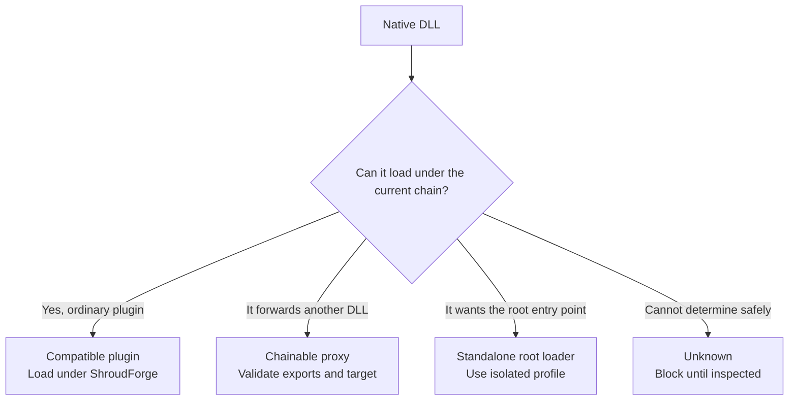
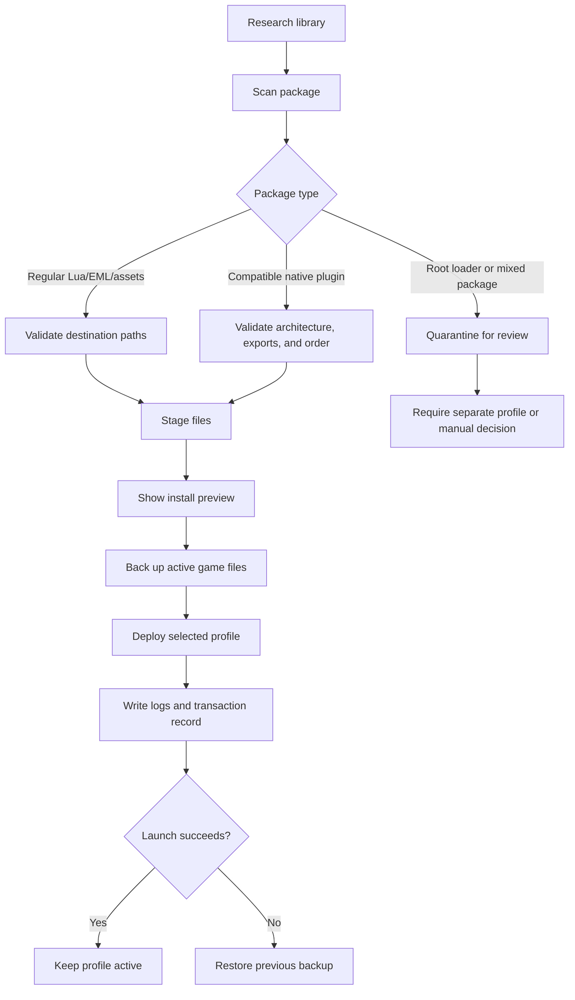
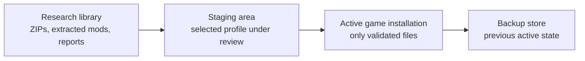
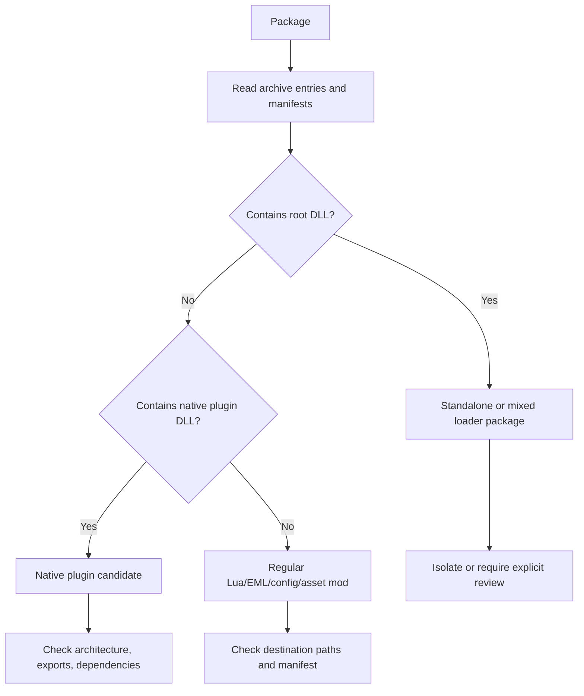
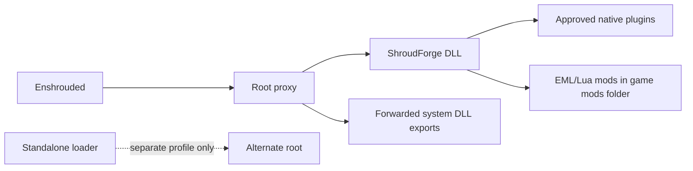
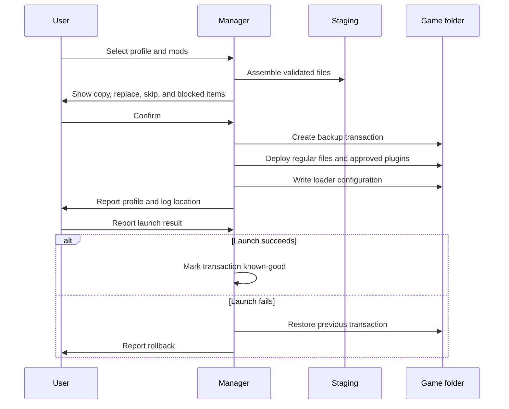

# Unified Proxy and Multi-DLL Loader — Builder's Blueprint

## Objective

Build one management tool that combines the useful parts of ModLoader Proxy and MultiDLL Installer while preserving ShroudForge's working DLL and loader path. The tool must provide ordered native-DLL loading, backups, configuration, validation, and reliable rollback.

The tool should also install ordinary non-DLL mods, such as Lua, EML, configuration, and asset packages, using the same staging, preview, backup, and rollback process.

## Primary requirement: preserve ShroudForge

ShroudForge remains the primary loader in its profile. The tool must not replace or rename ShroudForge's DLL merely to add compatible native mods. Instead, it should load approved plugin DLLs beneath the existing ShroudForge/proxy chain and make the order visible before activation.

The tool must classify every native DLL as one of:

- **Compatible plugin:** can be loaded by the existing chain.
- **Chainable proxy:** may be forwarded through a controlled proxy route after export and dependency validation.
- **Standalone root loader:** wants to own the game's entry point and must be isolated in a separate profile unless a verified forwarding route exists.
- **Unknown:** blocked until inspected.

Non-native packages receive a separate deployment classification:

- **Regular mod:** contains Lua, EML, configuration, or asset files and no root-loader DLL. It can be staged and copied to its declared game subfolder after path validation.
- **Mixed package:** contains both regular mod files and native or root-loader files. It must be split into components and reviewed before deployment.

### Category flow

In practical terms:

- **Compatible plugin** means the DLL is designed to be loaded by a loader and does not need to replace the game's root DLL. Creative, XHL plugins, and the M182 panel are examples in the current setup.
- **Chainable proxy** means the DLL is itself a forwarding layer. It may be usable, but only after checking exports, forwarding targets, and load order.
- **Standalone root loader** means the DLL expects to be the game's `dinput8.dll`, `winmm.dll`, or similar entry point. Shroudtopia and Stat Sliders are examples that should use isolated profiles.
- **Unknown** means the package lacks enough evidence. The tool should refuse to activate it automatically rather than guess.

## Recommended scope for version one

Version one should manage native Windows DLL mods for single-player or private testing. It should not rewrite ShroudForge or EML configuration, inject Lua, or attempt to make incompatible standalone loaders chain automatically.

## Core design

1. **Root proxy** — one supported game DLL name owns the game entry point and forwards all original exports; in the ShroudForge profile, this path must preserve ShroudForge.
2. **Manifest-based mod list** — each mod declares its DLL path, load order, dependencies, proxy status, and compatibility notes.
3. **Ordered loader** — explicit entries load first; dependency order is validated before launch and shown in a preview.
4. **Standalone-loader detection** — identify DLLs that expect to own the root entry point and require explicit confirmation or isolation.
5. **Backup manager** — create a timestamped backup of every root DLL and configuration file before changes, including the untouched ShroudForge files.
6. **Health check** — validate PE architecture, required exports, file presence, duplicate entries, and target paths before installation.
7. **Recovery mode** — restore the last known-good backup if launch fails or the user selects rollback.
8. **Logging** — record the selected profile, load order, forwarded target, DLL failures, and rollback actions.
9. **Regular package deployment** — copy validated non-DLL files into their declared destination, reject path traversal, and preserve the package's folder structure.

## Profiles

Use separate profiles instead of stacking incompatible loaders:

- **ShroudForge profile:** current working proxy plus ShroudForge forwarding and approved native plugins. ShroudForge remains present and is never silently replaced.
- **Standalone-loader profile:** an isolated profile for Shroudtopia, Stat Sliders, or another root-owning loader.
- **Clean profile:** no mod proxy, used to verify the unmodified game.

Only one profile should be active at a time.

## Installation flow

In plain language:

1. The tool treats the research folder as a library and never installs directly from an archive.
2. It scans the package and classifies regular files, compatible plugins, root loaders, and mixed content.
3. It stages only the selected files in a temporary profile.
4. It validates destinations, architecture, exports, dependencies, and load order.
5. It shows exactly what will be copied, replaced, or left untouched.
6. After confirmation, it backs up the active game files and deploys the profile.
7. It records the transaction and loader output.
8. If launch validation fails, it restores the previous profile.

## Detailed architecture walkthrough

### 1. Three storage areas

The research library is never treated as the live installation. The staging area is disposable and lets the tool inspect and assemble a profile before touching the game. The backup store preserves the previous active state for rollback.

### 2. Package classification

### 3. ShroudForge-preserving load chain

The normal profile keeps ShroudForge in the chain. A standalone loader is not inserted as an ordinary child plugin; it belongs to a separate profile unless a verified forwarding arrangement exists.

### 4. Preview and deployment transaction

## Milestones

### Milestone 1 — Read-only scanner

Inventory the game root and mod folders. Report DLL architecture, exports, likely proxy behavior, manifests, duplicates, and missing dependencies. Make no changes.

### Milestone 2 — Configuration generator

Generate a proxy configuration and ordered DLL list from a validated manifest. Display a preview and require explicit confirmation before writing.

### Milestone 3 — Backup and rollback

Create recoverable backups, write a transaction record, and restore the previous state if validation or launch checks fail.

### Milestone 4 — Profile switching

Add ShroudForge, standalone-loader, and clean profiles. Switching profiles must close the game, back up the current state, and verify the new root files.

### Milestone 5 — Launch diagnostics

Capture loader logs, identify the first failed DLL, and provide a one-click rollback without attempting unsafe automatic repairs.

## Major risks

- Incorrect export forwarding can prevent the game from starting.
- Loading a standalone `dinput8.dll`, `winmm.dll`, or similar as an ordinary plugin can crash or silently fail.
- DLL load order may affect hooks and shared dependencies.
- Game updates can invalidate native signatures even when the loader itself still works.
- Multiplayer and anti-cheat compatibility must remain out of scope unless separately verified.

## Success criteria

The first useful release should be able to scan the installation, produce a clear load plan, create a backup, activate one validated native-mod profile, write a complete log, and restore the previous profile without deleting user files.

## Implementation note

The existing ModLoader Proxy and MultiDLL Installer research is sufficient to define the behavior and safety boundaries, but not enough to claim binary compatibility with every loader. The new tool should begin as a profile manager around the proven proxy behavior, then add features only after each one is tested in an isolated profile.

## Client import finding

The current Enshrouded client executable imports `winmm.dll` and `dbghelp.dll`, but the inspected executable does not import `powrprof.dll`. Therefore `powrprof.dll` should remain a dedicated-server or alternate-profile option for this installation. The working client profile should continue using its existing `dinput8.dll` arrangement unless a separate `winmm.dll` or `dbghelp.dll` profile is deliberately tested.
